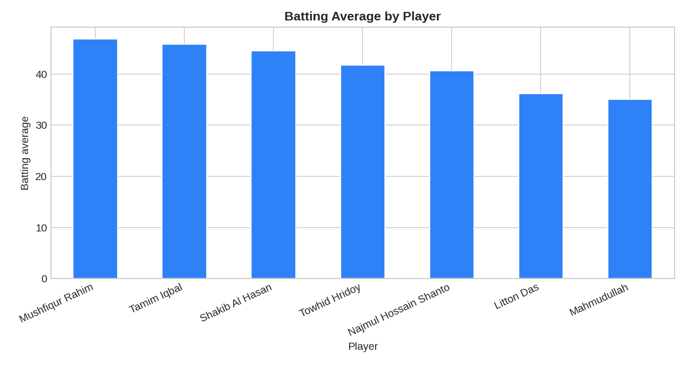
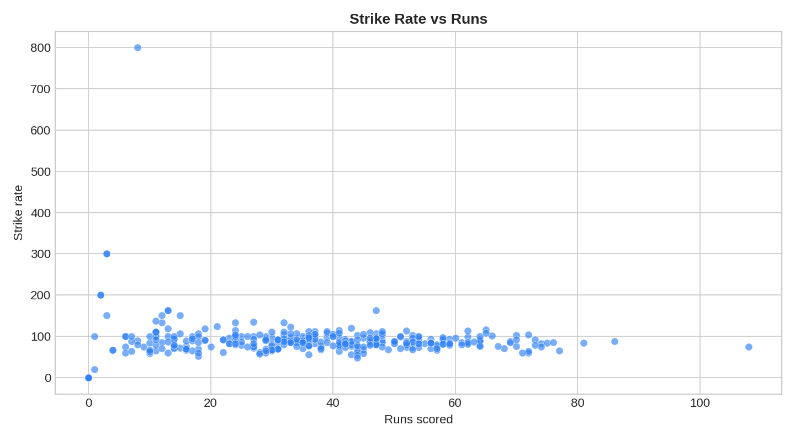
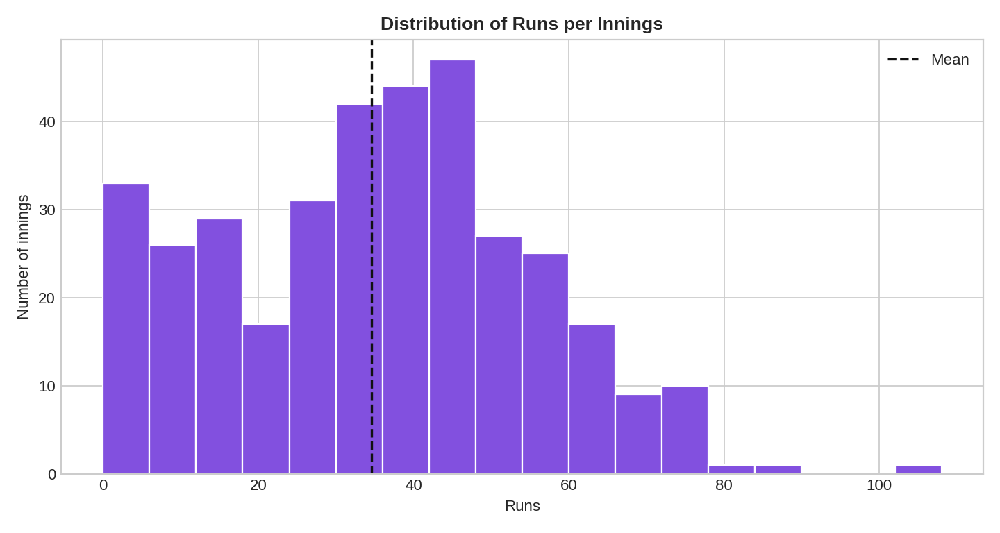

# Cricket Player Performance Analysis

A complete beginner-friendly **Data Science project** built with **Pandas, NumPy and Matplotlib**. It analyses batting performance — runs, strike rate, boundaries, fifties and centuries — across players, opponents and venues.

📖 **New here?** Read the full step-by-step explanation of everything in this project: [PROJECT_GUIDE.md](PROJECT_GUIDE.md)

> The dataset in this project is synthetic practice data generated with NumPy. The player names are real Bangladesh cricketers, but **all numbers are made up for practice** — they are not real match statistics.

## Project Highlights

- Generate a realistic innings-by-innings batting dataset with **NumPy**
- Clean and explore data with **Pandas**
- Compute batting averages, strike rates, 50s and 100s with `groupby` and aggregation
- Build clear visualizations with **Matplotlib**
- Save charts, tables and written insights automatically

## Questions This Project Answers

1. Which player has the highest batting average?
2. Which player scores fastest (highest strike rate)?
3. Who has scored the most fifties and centuries?
4. Against which opponent do batters score the most runs?
5. How are runs, balls faced, boundaries and strike rate related?

## Dataset Columns

| Column | Meaning |
|---|---|
| `match_id` | Match ID, e.g. M-001 |
| `player` | Batter name |
| `opponent` | Opposing team |
| `venue` | Home / Away / Neutral |
| `runs` | Runs scored in the innings |
| `balls_faced` | Balls faced in the innings |
| `fours` | Number of fours hit |
| `sixes` | Number of sixes hit |
| `dismissal` | Out / Not Out |
| `strike_rate` | Runs per 100 balls |
| `match_result` | Won / Lost |

## Project Structure

```text
cricket-player-performance-analysis/
├── README.md
├── requirements.txt
├── data/
│   └── cricket_performance_dataset.csv
├── src/
│   ├── generate_dataset.py
│   └── analysis.py
├── notebooks/
│   └── cricket_performance_analysis.ipynb
└── outputs/
    ├── insights.md
    ├── tables/
    │   ├── summary_statistics.csv
    │   ├── player_summary.csv
    │   ├── performance_by_opponent.csv
    │   └── correlation_matrix.csv
    └── charts/
        ├── average_runs_by_player.png
        ├── strike_rate_vs_runs.png
        ├── runs_distribution.png
        └── average_runs_by_opponent.png
```

## Quick Start

```bash
git clone <your-repository-url>
cd cricket-player-performance-analysis
pip install -r requirements.txt
python src/generate_dataset.py
python src/analysis.py
```

After running the analysis, open:

- `outputs/insights.md` for the key findings
- `outputs/charts/` for all visualizations
- `outputs/tables/` for the summary CSV files

## Sample Visualizations







## Tools Used

- **Python**
- **Pandas** — data cleaning, grouping and analysis
- **NumPy** — synthetic data generation and numerical work
- **Matplotlib** — charts

## Future Improvements

- Replace the synthetic dataset with real scorecard data
- Add bowling and fielding statistics
- Train a simple Machine Learning model with scikit-learn to predict runs
- Build an interactive dashboard with Streamlit

## Note

This project is for Data Science practice. The statistics here describe generated practice data only, not any player's real career.
